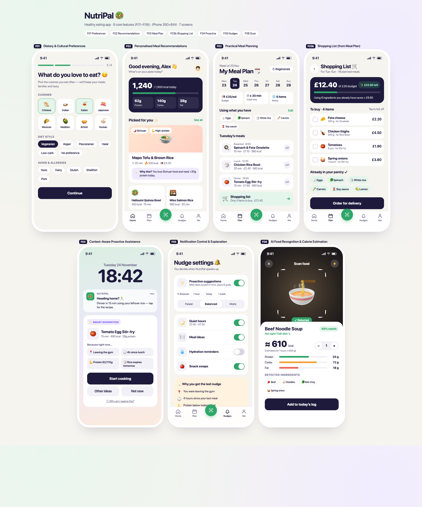

# NutriPal Figma Design Archive (2026-11-24)

**Language: [中文](README.md) | English**

## Source

- Figma: <https://www.figma.com/design/FzzqscVPbxGe2X56MfWBEW/NutriPal-%E2%80%93-Healthy-Eating-App?timeline=keyframe&node-id=0-1&p=f&t=6hx1mpAIOP6H6Jma-0>
- File: `NutriPal – Healthy Eating App`
- File key: `FzzqscVPbxGe2X56MfWBEW`
- Archive date: 2026-11-24
- User-provided static front-end export: `index.html`
- `index.html` SHA-256: `ee7ee7dc3d7ca5975c978ed53343afecf86a62badd190067468efba18831446e`

## Files

| File | Description |
| --- | --- |
| `index.html` | Self-contained front-end export provided by the user, containing seven screens and some click interactions; filename preserved |
| `screens-gallery.png` | Overview rendered from the HTML, 2000 × 2400 |
| `figma-thumbnail.png` | Public Figma file thumbnail, 800 × 358 |
| `screens/F01-preferences.png` | Dietary and cultural preferences |
| `screens/F02-recommendations.png` | Personalised recipe recommendations |
| `screens/F03-meal-plan.png` | Practical meal planning |
| `screens/F03b-shopping-list.png` | Shopping list |
| `screens/F04-proactive-assistance.png` | Context-aware proactive assistance |
| `screens/F05-nudge-settings.png` | Notification control and explanation |
| `screens/F06-food-recognition.png` | AI food recognition and calorie estimation |

Open `index.html` to view the scrollable static archive. The screen captures remove the “placeholder copy” guide outlines for easier review and report use.

## Acceptance results

| Check | Result |
| --- | --- |
| Source HTML copied with matching hash | Passed |
| All seven screens present (F01–F06 + F03b) | Passed |
| Overview and seven individual screen images rendered | Passed |
| Opens locally without a backend | Passed |
| Figma top-level comments transcribed | All eight archived; see [`../../figma/README.en.md`](../../figma/README.en.md#figma-comment-index) |
| Figma comment replies | Two replies not archived (#2 and #7 only record the presence of `1 reply`) |
| Pixel-identical to the Figma file | Partial: accent and surface colours in the static export are approximations |
| Interaction-prototype flow acceptance | Not performed: requires users to complete prototype tasks |

## Important notes

- The source HTML explicitly states that `#1E1A3C`, `#6E6A8A`, and `#FFFFFF` come from Figma, while accent and surface colours are approximations. The HTML and screenshots are suitable for review and archiving but are not a pixel-identical copy of the native Figma visual specification.
- Figma remains the design source of truth. If the live file changes, create a new dated archive rather than overwriting this one.
- This archive covers the visual and prototype layers only. It does not include real APIs, login, a database, a photo-recognition model, or a backend implementation.
