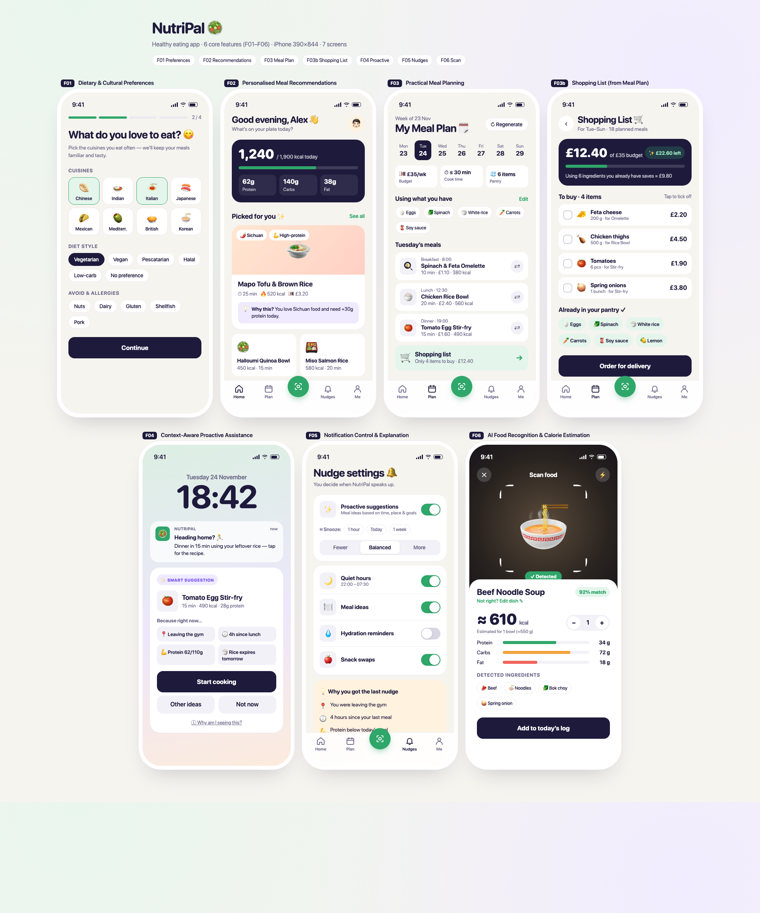

# NutriPal Figma 设计归档（2026-11-24）

## 来源

- Figma：<https://www.figma.com/design/FzzqscVPbxGe2X56MfWBEW/NutriPal-%E2%80%93-Healthy-Eating-App?timeline=keyframe&node-id=0-1&p=f&t=6hx1mpAIOP6H6Jma-0>
- 文件：`NutriPal – Healthy Eating App`
- File key：`FzzqscVPbxGe2X56MfWBEW`
- 归档日期：2026-11-24
- 用户提供的静态前端导出：`index.html`
- `index.html` SHA-256：`ee7ee7dc3d7ca5975c978ed53343afecf86a62badd190067468efba18831446e`

## 文件

| 文件 | 说明 |
| --- | --- |
| `index.html` | 用户提供的自包含前端导出，包含 7 个屏幕与部分点击交互；文件名保持原样 |
| `screens-gallery.png` | 从该 HTML 渲染的总览图，2000 × 2400 |
| `figma-thumbnail.png` | Figma 公开文件缩略图，800 × 358 |
| `screens/F01-preferences.png` | 饮食与文化偏好 |
| `screens/F02-recommendations.png` | 个性化食谱推荐 |
| `screens/F03-meal-plan.png` | 实用餐单规划 |
| `screens/F03b-shopping-list.png` | 购物清单 |
| `screens/F04-proactive-assistance.png` | 情境感知主动建议 |
| `screens/F05-nudge-settings.png` | 通知控制与解释 |
| `screens/F06-food-recognition.png` | AI 食物识别与热量估算 |

打开 `index.html` 即可查看可滚动的静态归档；屏幕截图已去除“placeholder copy”辅助虚线，方便评审与报告引用。

## 验收结果

| 检查项 | 结果 |
| --- | --- |
| 源 HTML 已复制且哈希一致 | 通过 |
| 7 个屏幕齐全（F01–F06 + F03b） | 通过 |
| 总览图与 7 张单屏图成功渲染 | 通过 |
| 本地打开不需要后端服务 | 通过 |
| 与 Figma 文件逐像素一致 | 部分通过：静态导出的强调色和底色为近似值 |
| 交互原型流程验收 | 未进行：需邀请用户完成原型任务再验证 |

## 重要说明

- `index.html` 的源文件注释明确写明：`#1E1A3C`、`#6E6A8A`、`#FFFFFF` 来自 Figma，强调色与表面色为近似值。因此该 HTML 与截图适合评审和归档，不应被当作 Figma 原生视觉规范的逐像素副本。
- Figma 仍是设计事实源；若线上文件继续修改，请新增日期化归档，不覆盖本次文件。
- 此归档只包含视觉与原型层，不包含真实 API、登录、数据库、照片识别模型或后端实现。
