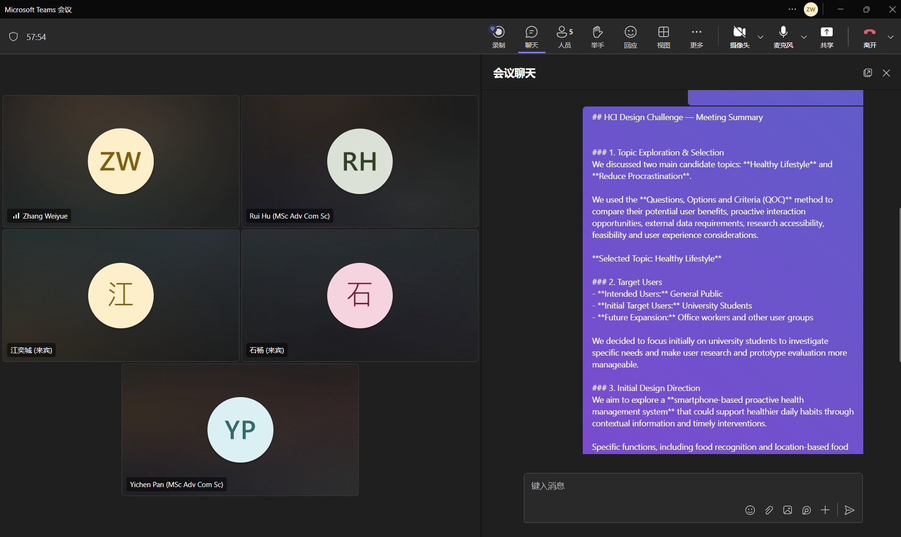
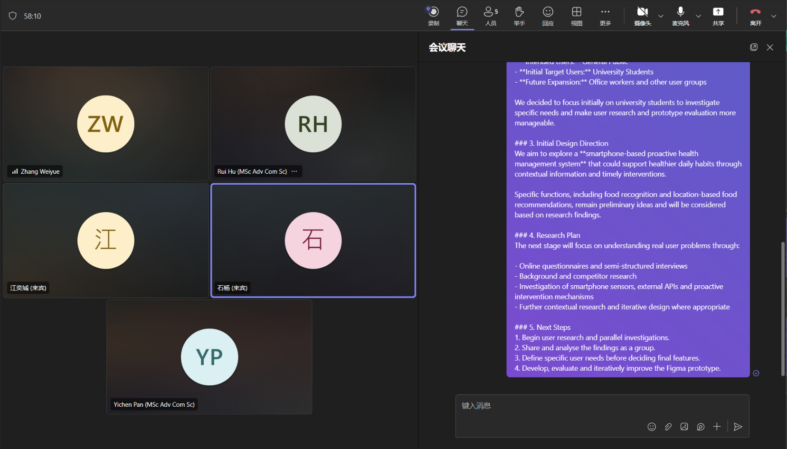
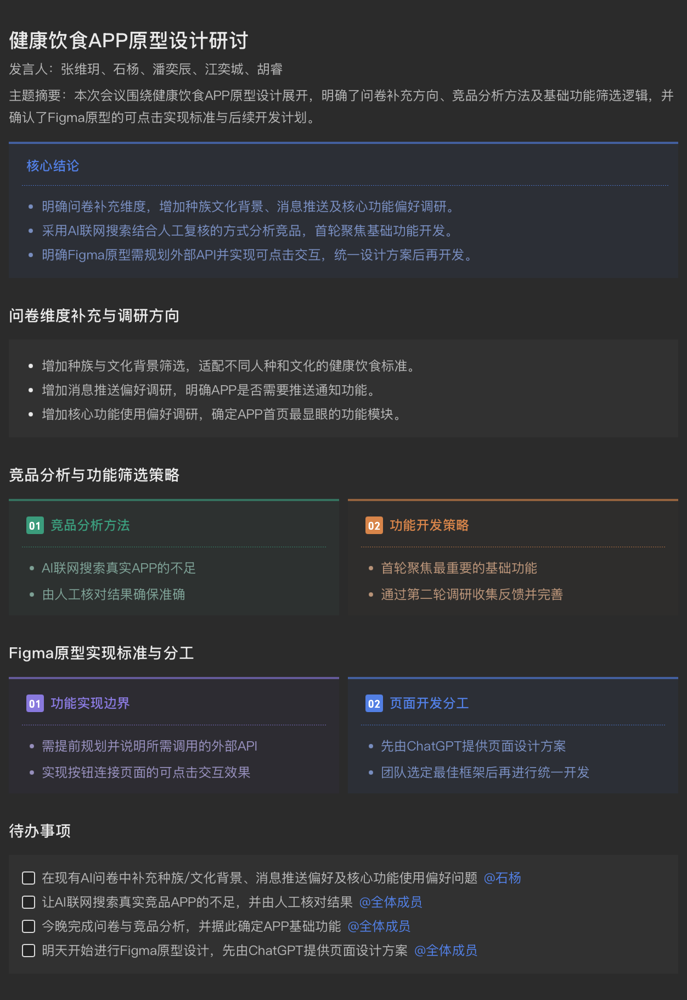

# HCI groupwork — Google Doc 源文档快照

> - 快照日期：2026-11-24（第二次抓取，包含第三次会议纪要）
> - 文档页首日期：2026/10/19
> - 页首阶段：Stage 0 – Problem Exploration
> 本文件保留源文档的正文信息；排版已转换为 Markdown，未补充源文档之外的结论。

## Date: 2026/10/19

## Stage: Stage 0 – Problem Exploration

### 1. Candidate Topics

**Option A: Healthy Lifestyle**

A smartphone-based system designed to support healthier daily habits, including nutrition, physical activity and potentially proactive health-related suggestions.

**Option B: Reduce Procrastination**

A proactive system intended to help users manage distractions and procrastination through contextual information and timely interventions.

### Background Analysis and Rationale for Selecting Healthy Lifestyle

#### 1. Background and Significance

Maintaining a healthy lifestyle is an important issue affecting people across different ages and backgrounds. Everyday behaviours, including physical activity and dietary choices, have significant implications for long-term health and well-being.

According to the World Health Organization (WHO, 2024), approximately 31% of adults worldwide, equivalent to 1.8 billion people, did not meet recommended levels of physical activity in 2022.

Dietary habits also present challenges. The Health Survey for England reported that only 29% of adults consumed at least five portions of fruit and vegetables per day in 2022. Among people aged 16–24, this figure was 25% (NHS England, 2024).

These findings suggest that supporting healthier everyday behaviours is a relevant issue with potential benefits for a broad population.

#### 2. Barriers to Healthy Habits

Healthy behaviours are influenced by more than individual motivation. Everyday responsibilities, available resources, social circumstances and competing priorities can affect people's ability to maintain their preferred routines.

A systematic review by Brown et al. (2024), covering 39 studies and 17,771 participants, identified lack of time, particularly in relation to academic demands, as a common barrier to physical activity among university students.

This highlights the importance of understanding people's actual circumstances rather than assuming that providing health information alone will address their difficulties.

#### 3. Relevance to Human-Computer Interaction

Healthy Lifestyle provides opportunities to explore how interactive technologies might support people in everyday situations.

Smartphone sensors, external data sources and user-defined preferences could potentially enable a system to respond to relevant contextual information and offer timely assistance.

However, whether proactive interventions would be useful or acceptable cannot be assumed. Their timing, relevance, privacy implications and level of user control will need to be investigated through user-centred research.

#### 4. Rationale for Topic Selection

Healthy Lifestyle was selected as the group's research direction because it combines a socially relevant problem area with opportunities to investigate context-aware and proactive interaction.

The intended audience is the general public. University students will be the initial research participants because they are accessible to the team and provide a practical starting point for investigating everyday health-related challenges.

The broad scope of Healthy Lifestyle is also recognised as a limitation. Questionnaires, interviews and competitor analysis will be used to identify specific unmet needs before deciding which problems and features the design should address.

#### References

- World Health Organization (2024). *Nearly 1.8 billion adults at risk of disease from not doing enough physical activity.* <https://www.who.int/news/item/26-06-2024-nearly-1.8-billion-adults-at-risk-of-disease-from-not-doing-enough-physical-activity/>
- NHS England (2024). *Health Survey for England, 2022 Part 1: Adults' health-related behaviours.* <https://digital.nhs.uk/data-and-information/publications/statistical/health-survey-for-england/2022-part-1/adults-health-related-behaviours>
- Brown, C. E. B., Richardson, K., Halil-Pizzirani, B., et al. (2024). Key influences on university students' physical activity: a systematic review using the Theoretical Domains Framework and the COM-B model of human behaviour. *BMC Public Health, 24*, 418. <https://doi.org/10.1186/s12889-023-17621-4>

### 2. Group Members' Initial Opinions

**Weiyue Zhang — Healthy Lifestyle**

- Proposed a smartphone-based proactive health management system to help people develop healthier daily habits.
- Suggested using smartphone data and user preferences to provide timely, personalised health suggestions without requiring users to open the app.
- Initially proposed food photo recognition, calorie estimation and activity tracking as potential features to be explored through user research and iteration.

**Shi Yang — Healthy Lifestyle**

- Expressed interest in the healthy eating direction.
- Raised concerns about unhealthy dietary habits and their potential health consequences.

**Jiang Yicheng — Healthy Lifestyle**

- Supported the health management direction.
- Considered health an increasingly relevant topic and suggested exploring opportunities in existing solutions.

**Hu Gaotuan — Reduce Procrastination**

- Proposed a smartphone- and smartwatch-based system to help users manage procrastination and distractions.
- Suggested using device activity, calendar information and proactive interventions to support concentration.
- Proposed giving users control over reminders, including postponing or dismissing them.

**Yichen Pan — Healthy Lifestyle**

- Supported the health management direction and suggested using statistical evidence to justify the topic's importance.
- Proposed analysing gaps in existing health management apps to identify unmet user needs.
- Suggested considering ethnic differences in health risks and cultural differences in lifestyle habits when designing user surveys and evaluating existing health apps.

### 3. QOC Comparison

| Criteria | Healthy Lifestyle | Reduce Procrastination |
| --- | --- | --- |
| Potential User Benefit & UX 潜在用户价值与用户体验 | 有助于养成更健康的日常习惯，包括体育锻炼和营养摄入。可能对广大人群适用，但具体需求仍需进一步研究。 | 可以帮助用户减少干扰，提高专注力。尤其适用于学生和有拖延症的人。 |
| Meaningful Proactive Intervention 有意义的主动介入 | 可以利用智能手机活动和上下文信息来确定适合提供个性化健康建议的时机，而无需用户打开应用程序。 | 可以监控相关设备活动，并在检测到潜在干扰时主动建议休息或专注训练。 |
| External Data & User Interaction 外部数据与用户交互 | 可以将智能手机传感器或外部 API 与用户目标和偏好相结合。用户可以接受、推迟或拒绝建议。 | 可以将屏幕使用时间信息和日历数据与用户自定义目标相结合。用户可以控制提醒和专注时段。 |
| Access to Research Participants 用户研究参与者的可接触性 | 目标受众为普通大众。由于大学生更容易接触到，因此我们将招募他们参与初步研究。之后还需要对其他人群进行进一步研究，以了解更广泛人群的需求。 | 目标受众可以包括普通大众，但初期研究将从大学生开始，因为他们更容易接触，也适合调查学习拖延和手机分心问题。不过，其他群体可能面临不同形式的拖延，因此后续需要扩大研究对象。 |
| Manageable Scope & Feasibility 项目范围的可控性与可行性 | 它提供了几种可能的功能，但必须根据用户调研缩小范围。基于智能手机的 Figma 原型是可行的。 | 虽然问题比较集中，但访问详细的应用程序使用数据或控制其他应用程序可能涉及技术限制。 |
| Privacy, Acceptability & User Control 隐私保护、用户接受度与用户控制权 | 需要谨慎处理健康相关信息，并把握合适的通知时机。用户应控制数据权限和提醒设置。 | 监控设备使用情况可能会引发隐私担忧，而频繁的干预可能会分散注意力。用户应控制监控和通知功能。 |

### 4. Final Topic Selection

**Selected Topic: Healthy Lifestyle**

**Reasons for Selection:**

- The topic has the potential to benefit a wide range of people by supporting healthier daily habits.
- It offers opportunities to develop a proactive smartphone-based system using external data and personalised interventions.
- It allows us to explore different health-related challenges through user research before deciding on the final system features.

**Design Direction:**

We will initially investigate everyday health habits and identify opportunities for meaningful proactive support. The specific problems and system functions will be refined based on user research findings.

### 5. Target User Selection

**Intended Users:** General Public

**Initial Target Users:** University Students

**Reasons for Selection:**

- The system is intended to support healthy daily habits across different user groups.
- University students were selected as the initial focus because our team can access this group for user research and prototype evaluation.
- Focusing on one group initially allows us to identify specific needs and develop a more targeted, evidence-based design.

**Future Expansion:**

Future research could explore the needs of office workers and other user groups. The system could then be adapted and iteratively improved based on their different lifestyles, habits and feedback.

### Preliminary Technical Feasibility Investigation

- **GPS:** Identify the user's approximate location and nearby places, potentially supporting location-based health suggestions. Supported by smartphones, but background location access is restricted and requires appropriate permissions.
- **Weather API:** Access weather conditions and forecasts to inform outdoor activity suggestions. Feasible through services such as Open-Meteo. Optional, depending on user research findings.
- **Notifications:** Proactively deliver health suggestions without requiring users to open the app. Supported by mobile operating systems, subject to notification permissions and background execution restrictions.
- **User Preferences:** Collect health goals, dietary preferences and reminder settings for personalised suggestions. Feasible through user input and app settings. This is not an external data source.
- **Recipe APIs:** TheMealDB 等食谱 API 获取食谱信息，再结合用户设置的菜系、预算和用餐时间进行推荐。

### 第一次会议截图

### 第一次会议任务

- 目标人群：所有人（先学生再补充别的群体）
- 收集市面上的相关应用总结好处坏处。
- 问卷调查：用户目前有哪些健康生活习惯？
  - 在饮食、活动、作息方面遇到哪些实际困难？
  - 目前怎样解决这些困难？
  - 现有健康 App 有哪些不足？
  - 用户是否接受系统主动提供健康建议？
  - 最后再了解用户希望获得哪些功能支持。
- 问卷要包括伦理声明，写在顶端。
- 写有关我们主题的背景分析，来支持我们为什么选择此主题。
- 明天前完成相关应用总结和问卷调查的问题，然后开始初步设计。

### 第二次会议

#### 一、问卷设计与竞品分析

会议首先对前期生成的 AI 问卷进行了评估，并针对人群差异、竞品分析可靠性及用户偏好补充了关键调研维度。

**1. 问卷维度补充**

- 增加种族与文化背景筛选：为适配不同人种和文化的健康饮食标准差异，需在问卷基本信息中增加种族与文化背景的筛选问题。
- 增加消息推送偏好调研：为明确 APP 是否需要推送通知功能，需在问卷中增加用户对消息通知类型与偏好的调查。
- 增加核心功能使用偏好调研：为确定 APP 首页最显眼的功能模块，需在问卷中增加用户最常用或最想用功能（如菜谱推荐、识别等）的偏好调查。

**2. 竞品分析与功能筛选**

- AI 竞品分析需人工复核：针对 AI 生成竞品不足时易产生幻觉的问题，需先让 AI 联网搜索真实 APP 的不足，后续再由人工核对确保结果准确。
- 首轮聚焦基础功能开发：初步开发阶段仅选取最重要的基础功能，后续可通过第二轮调研收集用户反馈，再逐步补充和完善特定功能。

#### 二、Figma 原型实现标准

会议明确了原型的开发边界与具体技术实现要求，确保设计符合项目规范。

**1. 功能实现边界**

- 需明确外部 API 需求：原型需具备现实可行性，需提前规划并说明所需调用的外部 API，如用于分析用户所在国家及推荐应季食物的天气与定位接口。
- 原型需支持交互跳转：Figma 原型需实现按钮连接页面的可点击交互效果，无需真正实现数据导入或拍照等底层功能。

**2. 页面开发分工**

- 统一设计方案后再开发：为避免多人分工导致页面风格不一致，计划先让 ChatGPT 提供几种页面设计方案，团队选定最佳框架后再进行统一开发。

#### 三、待办事项

- 在现有 AI 问卷中补充种族/文化背景、消息推送偏好及核心功能使用偏好问题。@石杨
- 让 AI 联网搜索真实竞品 APP 的不足，并由人工核对结果。@全体成员
- 今晚完成问卷与竞品分析，并据此确定 APP 基础功能。@全体成员
- 明天开始进行 Figma 原型设计，先由 ChatGPT 提供页面设计方案。@全体成员

### 第三次会议任务

1.选择App设计语言和设计交互逻辑
2.选择技术栈 ts
3.确定小组合作开发方式 模块设计 ->
4.确认哪些HCI中哪些理念直接使用到项目中 <https://canvas.bham.ac.uk/courses/90239/assignments/633304>

会议纪要：
会议纪要:

1、采用App交互方案：<https://www.figma.com/design/FzzqscVPbxGe2X56MfWBEW/NutriPal-%E2%80%93-Healthy-Eating-App?node-id=3-6&t=gFklYqEiCS336RVX-1> ，梳理交互方案中的模糊点

2、梳理和确定了问卷相关遗留问题：
    1) 保留问卷第4题
    2) 11题添加国内健康饮食APP，因为调查范围主要是身边的同学和朋友（国人）
    3) 去掉5、6题这样对于APP调研本身不起作用的问题
    4) 19、21限定多选题直接修改为多选题，不再限制多选个数
3、开发确定项：前后端分离开发，前端通过ts+前端组件，但是预留后端接口，保证可扩展
4、原型开发Roadmap:
    0) UI/UX选择（已确定）
    1) 系统设计
    2) 模块设计
    3) 实现
    4) 模拟用户反馈并持续迭代->2)
5、会后任务：
    1) 会后查找一下在HCI设计原则，并看哪些可以运用到项目中某些相关步骤的设计中。例：在问卷设计过程中出现double-barrelled questions，进行了问题拆分 @所有人
    2) 修改问卷中提到的几个小问题 @潘奕辰
    3) 原型开发 @胡睿

---

*源文档快照结束。*
