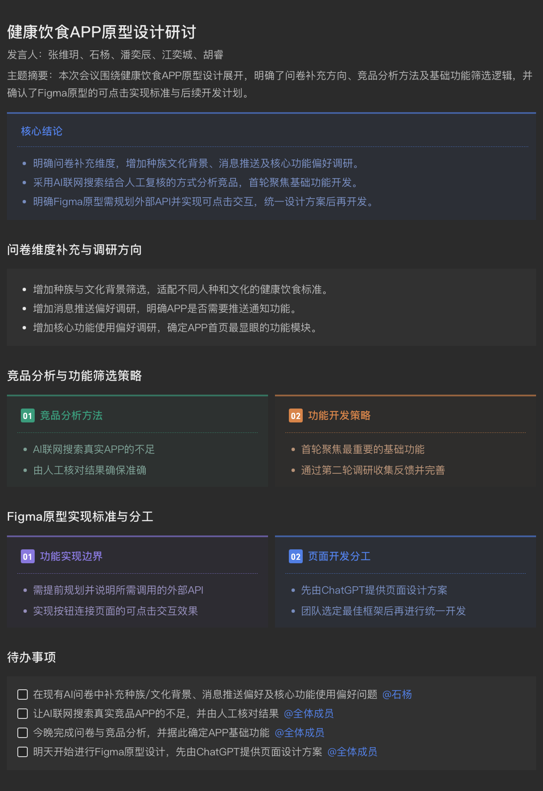

# 第二次会议：问卷、竞品与 Figma 原型

## 记录状态

- 日期：未记录
- 原标题：健康饮食 APP 原型设计研讨
- 来源：源文档第二次会议正文、待办事项及结构化截图

## 一、问卷设计与竞品分析

会议评估了前期生成的 AI 问卷，并识别出需要补充的调研维度。

### 1. 问卷维度

- 增加种族与文化背景筛选，以理解不同文化中的健康饮食标准差异。
- 增加消息推送偏好调研，判断 App 是否需要通知以及用户偏好哪些类型。
- 增加核心功能偏好调研，用于决定首页最显眼的功能模块。

### 2. 竞品分析与功能范围

- AI 联网搜索竞品不足后必须人工核对，防止幻觉。
- 首轮只开发最重要的基础功能。
- 通过第二轮调研收集反馈后，再补充特定功能。

## 二、Figma 原型标准

### 功能边界

- 提前规划并说明外部 API，例如用于国家/地区分析或应季食物推荐的天气与定位接口。
- 原型中的按钮必须连接页面，具备可点击交互。
- 无需真正实现数据导入或拍照识别等底层功能。

### 页面开发

- 先由 ChatGPT 提供多个页面设计方案。
- 团队选定最佳框架后再统一开发，避免多人设计造成风格不一致。

## 三、行动项

| 行动 | 负责人 | 原文时间 | 当前状态 |
| --- | --- | --- | --- |
| 为 AI 问卷补充种族/文化背景、通知偏好、核心功能偏好 | @石杨 | 未记录 | 要求已记录 |
| AI 联网搜索真实竞品不足并人工核对 | @全体成员 | 未记录 | 要求已记录 |
| 完成问卷与竞品分析，据此确定 App 基础功能 | @全体成员 | “今晚” | 待确认 |
| 开始 Figma 原型，先获得页面设计方案 | @全体成员 | “明天” | 待开始/待确认 |

## 会议原始总结

## 需要确认

- 会议日期和完整参会名单。
- 更新后的问卷、竞品分析结果和首轮基础功能是否已经产出。
- ChatGPT 页面方案是否已经评审。
